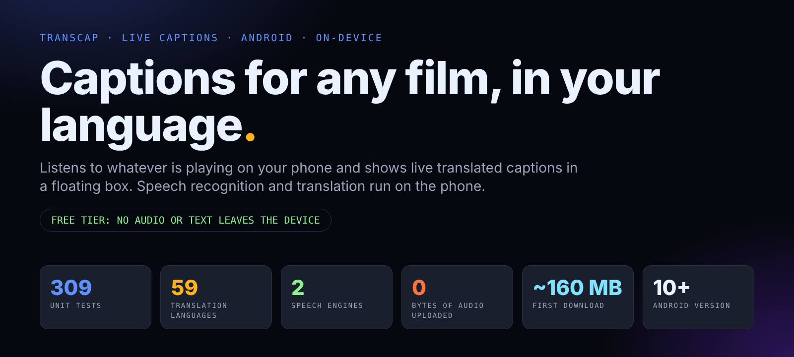
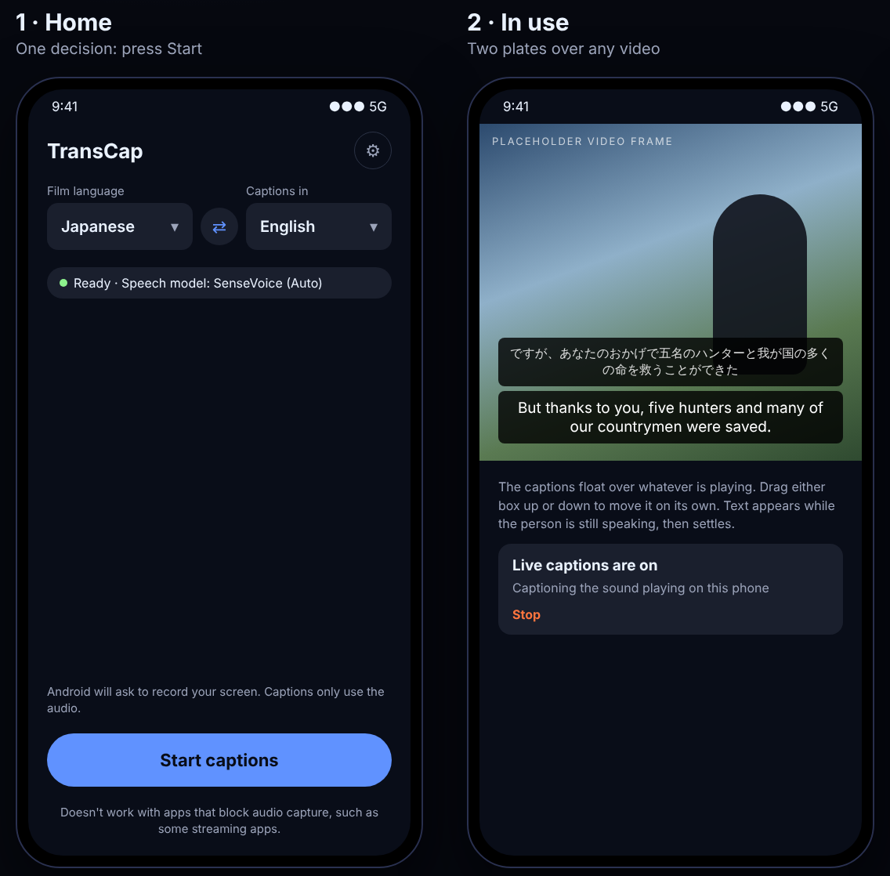
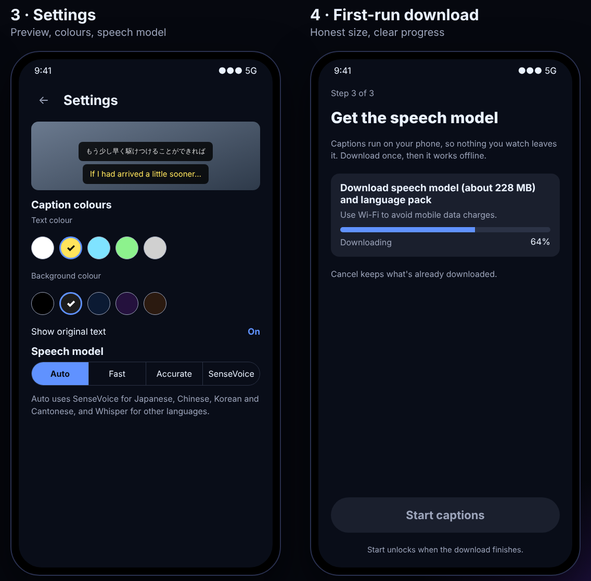

<p align="center"></p>

<p align="center">
<a href="#-quick-start">Quick start</a> ·
<a href="#-what-it-does">What it does</a> ·
<a href="#-privacy-and-safety">Privacy &amp; safety</a> ·
<a href="#-measured-so-far">Measured</a> ·
<a href="#-full-guide">Full guide</a> ·
<a href="#-runbook">Runbook</a>
</p>

## 🎬 What TransCap is

TransCap is an Android app that listens to whatever film or video is playing on your phone and shows **live translated captions in a floating box over any app**. Press Start, pick the film's language and your language, and watch. The free tier is fully on-device: speech recognition (Whisper and SenseVoice, via sherpa-onnx) and translation (ML Kit, or Whisper's own translate-to-English) both run on the phone.

<p align="center"></p>

> The images in this README are **design mockups** with placeholder video, drawn from the colour and layout tokens in [`DESIGN.md`](DESIGN.md). They are not device screenshots.

## ✨ What it does

| | |
|---|---|
| 🎧 **Listens to the phone** | Captures the audio that other apps play (AudioPlaybackCapture). No microphone needed, so room noise stays out. |
| 🗣️ **Recognises speech on the device** | Whisper (Fast ≈ 160 MB, Accurate ≈ 375 MB) or SenseVoice for Japanese, Chinese, Korean and Cantonese. **Auto model** picks the engine for the language. |
| 🌐 **Detects the language** | Choose *Auto-detect* and TransCap locks onto the film's language after a few agreeing sentences. |
| 🔁 **Translates on the phone** | Direct to English with Whisper, otherwise ML Kit. Offered in 59 translation languages. *Download all languages* (about 1.7 GB, Settings) makes every pack available offline. |
| ⚡ **Live captions** | Text shows while the person is still speaking, then settles. Display time grows with sentence length. |
| 🎵 **Marks music** | Background music shows as one `(music)` caption instead of wrong words. |
| 🎨 **Your style** | Separate boxes for the original line and the translation, drag each one, reset positions, text and plate colours, size stepper, opacity. |
| 🎥 **Records with captions** | Optional switch on Home: saves a video of your screen, with the caption boxes on it and the video's sound, to `Movies/TransCap`. It uses the same screen-sharing session as the captions, so it works where Android's own recorder would stop them. |
| 🔒 **Private by default** | Nothing is recorded or stored, and no audio or transcript is sent anywhere in the free tier. |

<p align="center"></p>

## 🚀 Quick start

**On a phone (Android 10 or newer):**

1. Install the debug APK you built (see below), open TransCap and allow the overlay permission when asked.
2. Choose **Film language** (or *Auto-detect*) and **Captions in**.
3. Wait for the one-time download: the speech model (about 160 MB for Fast) and, if needed, an ML Kit language pack (about 30 MB each).
4. Press **Start captions**, accept Android's screen-capture prompt (only the audio is used), then open your video.

**Build it yourself (JDK 17):**

```bash
./gradlew assembleDebug        # app/build/outputs/apk/debug/
```

TransCap will not hear apps that block audio capture, such as some streaming apps with DRM.

## 🔒 Privacy and safety

- The free tier processes audio on the device: speech recognition (Whisper and SenseVoice) and translation (ML Kit) run locally. Audio is never recorded or stored, and no audio or transcript is sent anywhere.
- The `INTERNET` permission is used only to download the speech models (from Hugging Face, pinned to a commit and SHA-256 verified) and the ML Kit language packs.
- Screen recordings (an optional switch) are saved only on the phone, in `Movies/TransCap`. Nothing is uploaded.
- Android asks for screen-capture permission because that is how it exposes playback audio. TransCap only reads the audio. The overlay permission draws the caption boxes.
- ML Kit's bundled APIs may send anonymous performance and usage metrics to Google. No audio or text is included, but this is network traffic beyond the downloads above.
- Before any store listing, a real privacy policy must describe the above (including the ML Kit metrics). Nothing here is a statement of legal compliance.
- A cloud tier is planned as a later, separate component. It is not part of the free tier and would need its own privacy review (see [backend design](docs/design/2026-10-17-paid-tier-backend-design.md)).

## 📊 Measured so far

Field tests on a Samsung Galaxy S26 Ultra with anime and reels, plus container tests:

| Finding | Result |
|---|---|
| Decode time per sentence | Whisper base 0.2–0.6 s, Whisper small 0.7–1.4 s, SenseVoice 51–118 ms |
| Japanese, Chinese, Korean | SenseVoice (2024-07-17 build) is faster and more accurate than Whisper. The 2025-09-09 build gave wrong output, so the older one is pinned. |
| Language ID | Correct for ja, en, ko and zh. SenseVoice's own auto mode also got Cantonese. |
| Known weak spots | Whisper's translate mode can repeat itself, ML Kit wording can be awkward. |

A formal on-device benchmark ([`docs/benchmarks/free-tier.md`](docs/benchmarks/free-tier.md)) has **not been run yet**. Treat these numbers as field observations.

## 📚 Full guide

| Document | What is in it |
|---|---|
| [`DESIGN.md`](DESIGN.md) | Colour tokens, type, components, logo and rules for anyone changing the UI |
| [App design v2](docs/design/2026-10-17-transcap-app-design-v2.md) | Features, colour, screens and UX copy |
| [Free-tier spec](docs/superpowers/specs/2026-10-17-live-translated-captions-design.md) | Pipeline and decisions |
| [Free-tier plan](docs/superpowers/plans/2026-10-17-android-free-tier.md) | Build plan |
| [Paid-tier backend design](docs/design/2026-10-17-paid-tier-backend-design.md) | Planned cloud speech tier |
| [Deepgram latency proof](docs/superpowers/plans/2026-10-17-deepgram-latency-proof.md) | Plan to test cloud latency first |
| [Logo files](docs/design/logo) | Mark, lockup, icon |

How it works inside: `AudioCapture → FrameChunker → VadSegmenter (Silero) → recognizer → translator → CaptionStabilizer → OverlayRenderer`.

## 🛠️ Runbook

```bash
./gradlew testDebugUnitTest    # 309 unit tests
./gradlew lintDebug
./gradlew assembleDebug
```

- **CI** runs all three on every pull request (`.github/workflows/ci.yml`, JDK 17).
- **Smaller test APK:** the build includes three ABIs. For a faster build, temporarily set `abiFilters` in `app/build.gradle.kts` to `arm64-v8a`.
- **Diagnostics:** debug builds show a stats line (queue, decode time, lag, detected language) to help tune speed and accuracy.
- **Settings:** `minSdk 29`, `targetSdk 34`, application id `com.voicecaption`, version 0.1.0.

## 🗺️ Status

Early. The free tier works end to end on a real phone. Not yet done: a searchable language list, a formal benchmark, `targetSdk 35`, store packaging and a privacy policy. **No `LICENSE` file has been added yet**, so no licence is granted until one is.
