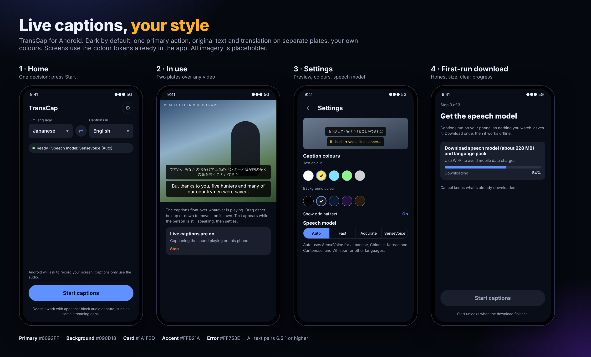

# TransCap App Design v2 (features, colour, UI/UX, copy)

Date: 2026-10-17
Status: Draft for review
Maturity: **L1 (design language defined)** since `DESIGN.md` was added at the repository root; this
document was written at L0, so its values were provisional. The colour values are the ones already
in the app's theme (`ui/theme/Color.kt`, from the generated palette), so the document matches what
is built. `DESIGN.md` is now the source of truth for tokens and rules; this document keeps the
screens, feature list and copy.

Supersedes the Android part of `2026-10-17-android-ui-and-landing-page.md`, which described the
first free-tier build. The landing page part of that document is unchanged.

All imagery in the sheet is placeholder (a drawn gradient, not footage). Screens are a design
reference, not screenshots.

## 1. What changed since the first design

| Area | First design | Now |
|---|---|---|
| Speech recognition | Whisper base or small | **Auto**: SenseVoice for Japanese, Chinese, Korean and Cantonese; Whisper for other languages. Fast, Accurate and SenseVoice can still be chosen |
| English captions from a foreign film | Transcribe, then translate with ML Kit | Whisper translates straight to English (more accurate in field tests) |
| Caption timing | Caption appears after the sentence ends | **Live partial captions**: text appears while the person is speaking and is replaced by the final text |
| Caption layout | One plate; original text as a smaller first line | **Two plates**: original text above, translation below |
| Caption style | Size and opacity | Size, opacity, **text colour, background colour**, contrast warning |
| Display time | Fixed 4 s | Scales with text length (4 to 9 s) |
| Film language | Always chosen by hand | **Auto-detect** option: the app listens and finds the language |

## 2. Feature inventory

### In the current build
1. **Capture**: system audio of any app that allows it (AudioPlaybackCapture). Blocked apps get a plain message.
2. **Speech model, Auto by default.** Explicit choices: Fast (Whisper base), Accurate (Whisper small), SenseVoice.
3. **Live translation**: Whisper direct (to English) or ML Kit (all other pairs), on the phone.
4. **Live partial captions**, refreshed every 0.8 s (SenseVoice) or 1.5 s (Whisper).
5. **Two plates**: original-language box (smaller, slightly softer text) above the translation box. Each box is moved on its own; the original box stays stacked above the translation box until it is moved. A line not yet translated shows in the original box only. "Reset caption positions" in Settings.
6. **Caption style**: size 14 to 32 sp (slider, or a - / + stepper for one-step changes), background opacity 50 to 100 %, five text colours, five background colours, custom `RRGGBB`, contrast warning below 4.5:1.
7. **Languages**: 57 film and caption languages (the set both Whisper and ML Kit support). Swap button. The film language can also be **Auto-detect**: Whisper listens to the first sentences and names the language (it locks after two agreeing sentences of at least one second each, and stays for the session). Chinese, Japanese, Korean and Cantonese then move to SenseVoice if it is installed and the caption language is reachable; everything else stays on Whisper. Until the language is known, captions show the original text without translation (with English captions Whisper translates from the start, so this only affects other caption languages). Swap is off while Auto-detect is chosen.
8. **Music caption**: when the audio is only music, the translation box shows **(music)**. SenseVoice reports a background-music event; Whisper writes a music tag or note symbols; either, with no words, gives the caption. It stays as one caption while the music lasts, and words (including sung lyrics) are captioned as words. Music never counts when Auto-detect decides the film's language. Other sounds (applause, laughter) stay silent.
9. **Storage**: download, size shown, delete with confirmation.
10. **Diagnostics line** (debug builds only): model, segment length, decode time, lag, raw recognizer text.

### Designed here, not built yet
| Proposal | Why | Source |
|---|---|---|
| Searchable caption-language list with a downloaded state and size per language | Shows what is ready offline before the user starts | Reference screenshots |
| Remember the box positions across app restarts | Saved when you let go of a drag; Reset clears them | Done |
| First-time hint explaining that live text can change | Prevents "the caption changed" confusion | Field test |

## 3. Colour

Dark is the default (it sits next to video). A light theme follows the system setting.

### Interface tokens (Android theme)
| Token | Dark | Light | Use |
|---|---|---|---|
| background / surface | `#090D18` | `#FFFFFF` | Screens |
| card | `#1A1F2D` | `#F2F5FB` | Grouped content, download card |
| text | `#EAF2FF` | `#090D18` | Body and titles |
| secondary text | `#9CA4BA` | `#555D72` | Helper text, labels |
| primary | `#6092FF` | `#2439EE` | Start button, selected controls, progress |
| text on primary | `#090D18` | white | Button labels |
| accent | `#FFB21A` | `#FFB21A` | Highlights; always with dark text |
| error | `#FF753E` | `#AE1B00` | Stop, errors, contrast warning |

Measured contrast (WCAG): text on background 17.2:1; secondary text 7.8:1 (6.6:1 on cards);
primary on background 6.5:1; button label on primary 6.5:1; error on background 7.3:1; accent
with dark text 10.7:1. Light theme: primary 7.3:1, secondary 6.6:1, error 7.1:1. Every pair is
at or above 4.5:1.

### Caption plate colours (user choice)
| Setting | Presets | Default |
|---|---|---|
| Text | white `#FFFFFF`, yellow `#FFE45C`, cyan `#7FE3FF`, green `#8DF28D`, light grey `#D0D0D0` | white |
| Background | black `#000000`, dark grey `#1C1C1C`, navy `#0B1A33`, purple `#24113D`, brown `#2B1A10` | black |

All 25 preset pairs measure 10.8:1 or higher. A custom pair below 4.5:1 shows a written warning
(never colour alone). The background slider (50 to 100 %) controls transparency only; colours are
always stored opaque so the two settings never fight.

## 4. Typography and spacing

System font (Roboto). Scale 12 / 14 / 16 / 20 / 24 / 32 sp. Caption text 18 sp by default, 14 to 32 sp by
choice; the original-language plate is drawn at 80 % of that. Spacing base 8 dp, mini-unit 4 dp
(4, 8, 12, 16, 24, 32, 48). Touch targets 48 dp or more (swatches are 48 dp; the Start button is 56 dp
tall). Plate: radius 8 dp, padding 12 dp, 6 dp gap between plates.

## 5. Screens

### 5.1 Home
One decision: press Start. Language pair (film language, swap, captions in), one status line, one
primary button, the consent note above it and the blocked-app note below.

| Zone | Content |
|---|---|
| Header | App name, Settings button (48 dp) |
| Language pair | Two fields with a swap button between them; the film language can be Auto-detect (swap is off then, with a one-line explanation) |
| Status chip | State plus the model that will run, e.g. "Ready · Speech model: SenseVoice (Auto)" |
| Primary action | **Start captions** / **Stop captions**, full width, 56 dp |
| Notes | Screen-record consent explanation; DRM limit |

States: Setup needed, Download needed (opens the download card), Downloading, Download failed,
Ready, Listening, Not started (consent dismissed). Start is disabled with a one-line reason until ready.

### 5.2 In use (overlay)
- Two plates, bottom centre, at most 90 % of the screen width, each up to five lines (no cut-off).
- Original plate appears only with "Show original text". The translation plate is always the main one.
- A caption stays up for its reading time: 4 s minimum, longer for long text, 9 s at most.
- Live text may be replaced by better text as more speech arrives; the final text replaces the live text in place.
- Each box is dragged up or down on its own. The original box follows the translation box until you move it. Touches outside the boxes reach the video.
- Messages (blocked app, missing language pack) use the translation plate.

### 5.3 Settings (top to bottom)
1. Preview (both plates, current colours, size and opacity)
2. Caption size (slider with a - / + stepper), Caption background (opacity)
3. Caption colours: Text colour, Background colour (swatches + custom field), contrast warning
4. Show original text (switch)
5. Speech model: Auto, Fast, Accurate, SenseVoice, with a helper line for Auto
6. Languages
7. Storage (installed models, sizes, delete)

### 5.4 First-run
Three steps: what it does (with the DRM limit), permissions (overlay, notifications, audio capture, each with a reason), languages and download (size shown, Wi-Fi hint, progress, cancel, retry).

## 6. Interaction and state rules
| Situation | Behaviour |
|---|---|
| Model not downloaded | Start disabled; download card shows exact size |
| Offline, pack missing | One-time message on the plate; original text still shown |
| App blocks audio capture | After about 5 s of silence while media plays: plain message with a next step |
| Auto-detect, language not known yet | Captions show the original text without translation; with English captions Whisper translates straight away |
| Auto-detect, caption language not English | Needs the language pack of the detected language; if it is missing the existing "translation isn't ready" message appears |
| Contrast below 4.5:1 | Written warning in Settings; the choice is still allowed |
| Settings change while running | Style applies to the next caption; model changes apply on the next Start |
| Delete model while running | Disabled, with a reason |

## 7. Accessibility
- Every control has a content description; selected swatches say "selected" and show a ring and a tick.
- Text and control pairs measure 4.5:1 or more; the contrast warning protects custom colours.
- Respects system font size and the dark/light setting. Check at 200 % font size before release.
- The overlay is hidden from TalkBack per caption update (constant interruptions); status line changes are announced.

## 8. Heuristic check
| Heuristic | Finding | Severity | Adjustment |
|---|---|---|---|
| Visibility of system status | The model that will run was not shown | P2 | Status chip shows it |
| Match with the real world | "plate" is an internal word | P2 | Copy says "box" |
| User control | Plates could not be placed separately | P3 | Fixed: each box moves on its own; Reset caption positions in Settings |
| Error prevention | Unreadable colour pairs are possible | P2 | Contrast warning |
| Recognition over recall | Auto hides which model runs | P2 | Helper line + status chip |
| Honesty | Live text can change | P2 | First-time hint |

## 9. UX copy

Terms: **caption** (the text shown), **box** (one of the two caption boxes), **film language**,
**captions in**, **speech model**, **language pack**. The app name is **TransCap** (`app_name`
in `strings.xml`, the theme and the manifest all use it).

### Recommended copy
| Element | Current | Recommended | Why |
|---|---|---|---|
| App name | Voice Caption | TransCap | Chosen name; applied in the app (the package id `com.voicecaption` is unchanged so installed copies update) |
| Status chip | Ready | Ready · Speech model: SenseVoice (Auto) | Shows what will run |
| Audio blocked | This app doesn't allow audio capture | Can't hear this app. It blocks audio capture. Try another player. | Says what happened and what to do |
| Recognizer failed | Couldn't recognize speech. Try the other speech model in Settings, or re-download it. | Captions stopped: the speech model isn't working. In Settings, pick another model or download it again. | Starts with the result |
| Translation failed | Translation failed; showing the original text. | Couldn't translate this line. Showing the original. | Shorter, no semicolon |
| Pack missing | Translation pack not downloaded. Open the app to download | Translation isn't ready. Open TransCap to download the language pack. | Consistent term, full stop |
| Show original text helper | (none) | Adds a smaller box with the film's own language above the translation. | Explains the second box |
| Auto helper | Auto uses SenseVoice for Japanese, Chinese, Korean and Cantonese, and Whisper for other languages. | Auto picks the best speech model for the film's language: SenseVoice for Japanese, Chinese, Korean and Cantonese, Whisper for the rest. | States the benefit first |
| Contrast warning | Warning: these colours are hard to tell apart. Captions may be difficult to read. | Low contrast: captions may be hard to read. Try white text on a dark background. | Gives the fix |
| Hex field error | Use six digits or letters A to F | Enter 6 characters: 0 to 9 and A to F | Clear and short |
| Download hint | (none) | Use Wi-Fi to avoid mobile data charges. | Sets expectations before a 240 MB download |
| Live text hint (first run of captions) | (none) | Captions appear as people speak and may change as more words arrive. | Prevents confusion |
| Move hint | (none) | While captions are on, drag each caption box up or down to place it. | Teaches the gesture (in Settings) |
| Music only | (nothing shown) | (music) | Matches the common caption convention; same word in every UI language until translated *(intent)* |
| Film language, detect for me | (none) | Auto-detect | Short, matches the other options |
| Auto-detect helper | (none) | TransCap listens to the first sentences to find the film's language. Works best when captions are in English. | Says how it works and its limit |
| Cancel download | Cancel download | Cancel download (keeps what's already downloaded) | Describes the consequence |

### Alternatives for the three most important lines
| Line | Option | Copy | Tone | Best for |
|---|---|---|---|---|
| Audio blocked | A (recommended) | Can't hear this app. It blocks audio capture. Try another player. | Plain, helpful | Overlay message |
| | B | This app blocks audio capture, so TransCap can't caption it. | Neutral | Longer help text |
| | C | No audio from this app. Try a different player. | Brief | Notification |
| Contrast warning | A (recommended) | Low contrast: captions may be hard to read. Try white text on a dark background. | Direct | Settings |
| | B | These two colours look alike. Pick colours that stand out from each other. | Friendly | Onboarding tone |
| | C | Hard to read. Change a colour. | Terse | Very small screens |
| Auto helper | A (recommended) | Auto picks the best speech model for the film's language: SenseVoice for Japanese, Chinese, Korean and Cantonese, Whisper for the rest. | Informative | Settings |
| | B | Auto chooses for you based on the film's language. | Short | Home status help |
| | C | Best model, picked for you. | Minimal | Chip tooltip |

### Rationale
Errors state the result first, then the cause, then the next step. Terms stay the same everywhere
(speech model, language pack, caption box). Names of models (Whisper, SenseVoice) stay as written.
Buttons use verbs.

### Localization notes
- Expect 30 % longer text in German, French and Spanish; the Settings segmented control (four
  labels) must wrap or shorten at large font sizes.
- "Wi-Fi", "Whisper", "SenseVoice", "TransCap" are not translated.
- Avoid idioms ("hard to tell apart" is simple, but "stand out" may not translate well).
- File sizes use the phone's number format ("228 MB").
- Right-to-left languages: boxes stay centred; the original box may contain mixed-direction text.

## 10. Open questions
1. Build the remaining proposals in section 2 (searchable language list, saving the box positions)?
2. Logo and app icon are done (`docs/design/logo/`); a Play Store feature graphic and screenshots are not.
3. The domain `rt.transcap.app` and the store product id in the backend design are placeholders; availability of the name, domain and store listing has not been checked.
